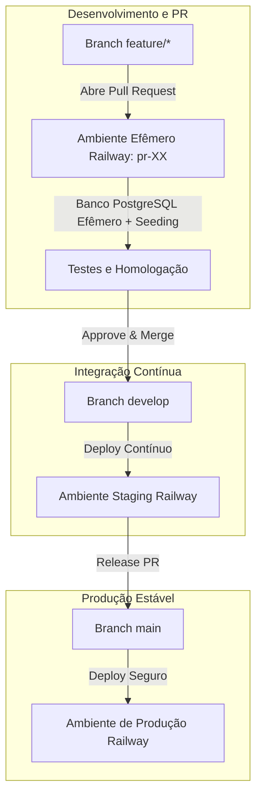

# 🚗 Sistema de Gerenciamento de Oficina Mecânica

<p align="center">
  
  
  
  
  
  
  
</p>

Sistema web completo para automação, controle operacional e gestão de oficinas mecânicas e centros automotivos. Desenvolvido como projeto de conclusão de curso (**TCC II - Engenharia de Software**), o sistema adota padrões consolidados de engenharia, arquitetura em contêineres, testes contínuos e entrega automatizada com ambientes efêmeros.

---

## 📌 Sumário

1. [Visão Geral dos Módulos](#-visão-geral-dos-módulos)
2. [Stack Tecnológica e Arquitetura](#-stack-tecnológica-e-arquitetura)
3. [Credenciais de Teste](#-credenciais-de-teste)
4. [Como Executar Localmente](#-como-executar-localmente)
   - [Opção 1: Via Docker (Recomendado)](#opção-1-via-docker-recomendado)
   - [Opção 2: Ambiente Local sem Docker](#opção-2-ambiente-local-sem-docker)
5. [Ambientes e Pipeline de CI/CD (Railway)](#-ambientes-e-pipeline-de-cicd-railway)
6. [Fluxo de Desenvolvimento e Contribuição](#-fluxo-de-desenvolvimento-e-contribuição)
7. [Documentação Técnica (Pasta Docs)](#-documentação-técnica)
8. [Licença e Autoria](#-licença-e-autoria)

---

## 🚀 Visão Geral dos Módulos

O sistema é dividido em painel operacional/administrativo interno e portal público do cliente:

### 1. Gestão de Ordens de Serviço (OS)
- **Ciclo de Vida Completo:** Abertura, diagnóstico, orçamento, execução, conclusão e cancelamento.
- **Numeração Automática:** Formato sequencial anual padronizado (`AAAA000001`).
- **Itens e Precificação:** Adição dinâmica de peças e serviços com cálculo automático de subtotal, descontos e total.
- **Emissão em PDF:** Geração de espelho da OS para impressão ou envio ao cliente via `barryvdh/laravel-dompdf`.

### 2. Checklist e Inspeção Veicular
- Vistoria de entrada com 12 pontos essenciais (lataria, nível de óleo, pneus, vidros, freios, etc.).
- Registro de fotos e observações por ponto de vistoria para segurança jurídica da oficina e transparência com o cliente.

### 3. Controle de Estoque e Catálogo
- Cadastro unificado de serviços de mão de obra e peças de reposição.
- **Baixa Automática:** Decremento automático do estoque ao vincular peças à OS.
- **Restauração em Cancelamento:** Devolução automática do estoque ao cancelar a OS ou desvincular itens.
- Alertas visuais e relatórios de **estoque mínimo** e **estoque crítico**.

### 4. Controle de Acesso e Gestão de Funcionários (RBAC)
- **Administrador:** Acesso irrestrito a relatórios financeiros, configurações, faturamento e gestão de equipe.
- **Mecânico:** Interface focada apenas nas OS atribuídas a ele, checklist de tarefas e atualização de status operacional.
- Controle de **SLA de tarefas** atribuídas a cada mecânico.

### 5. Clientes e Veículos
- Relacionamento 1:N entre clientes e veículos.
- Histórico completo de manutenções e passagens na oficina registrado por placa.
- Validação estrita de CPF, telefones e regras de duplicidade.

### 6. Agendamento e Recepção
- Agendamento prévio por clientes cadastrados ou visitantes.
- Painel de aprovação pelo administrador com conversão automática de agendamento em Ordem de Serviço, cliente e veículo no sistema.

### 7. Portal do Cliente e Consulta Pública
- **Área Logada do Cliente (`/portal`):** Histórico de ordens, orçamentos pendentes, aprovação digital e agendamento.
- **Consulta Pública (`/portal/consulta`):** Consulta simplificada e rápida informando apenas **CPF + Placa**, sem necessidade de login prévio.

---

## 🛠 Stack Tecnológica e Arquitetura

| Camada | Tecnologia | Detalhes |
| :--- | :--- | :--- |
| **Backend** | PHP 8.4-FPM + Laravel 12 | Arquitetura MVC, Eloquent ORM, Form Requests, Seeders |
| **Frontend** | Blade + Vite + JavaScript / CSS | Interface responsiva, modais dinâmicos, assets compilados |
| **Banco de Dados** | PostgreSQL 16 | Relacional, transações ACID, integridade referencial estrita |
| **Cache & Sessão** | Redis 7 | Gerenciamento de sessões, cache e rate limiting |
| **Servidor Web** | Nginx (Alpine Linux) | Roteamento HTTP reverso, compressão gzip e headers seguros |
| **Contêineres** | Docker & Docker Compose | Multi-stage build com parity dev/prod e entrypoint dinâmico |
| **Cloud / CI/CD** | Railway | Deploy contínuo, staging isolado e PR Environments efêmeros |

---

## 🔑 Credenciais de Teste

Para facilitar a homologação e demonstração, o sistema conta com seeders pré-configurados:

| Interface | URL | Identificador / E-mail | Senha | Perfil |
| :--- | :--- | :--- | :--- | :--- |
| **Painel Admin** | `/login` | `admin@oficina.com` | `admin123` | Administrador Completo |
| **Painel Mecânico**| `/login` | `mecanico@oficina.com` | `mecanico123` | Mecânico / Operacional |
| **Portal do Cliente**| `/portal` | CPF `529.982.247-25` | `cliente123` | Cliente com Veículo e Histórico |
| **Consulta Pública** | `/portal/consulta` | CPF `529.982.247-25` | Placa: `ABC1D23` | Consulta de OS sem login |

---

## 💻 Como Executar Localmente

### Opção 1: Via Docker (Recomendado)

O projeto conta com ambiente completo e orquestrado via `docker-compose`:

1. **Clone o repositório:**
   ```bash
   git clone https://github.com/VitorHugoaaaaaaas/sistema-oficina.git
   cd sistema-oficina
   ```

2. **Copie o arquivo de variáveis de ambiente:**
   ```bash
   cp .env.example .env
   ```

3. **Inicie os contêineres:**
   ```bash
   docker compose up -d --build
   ```
   *O contêiner executa automaticamente a compilação do Vite, link do storage, migrations do PostgreSQL e criação dos usuários de teste.*

4. **Acesse a aplicação no navegador:**
   > [http://localhost:8000](http://localhost:8000)

5. **Para parar os serviços:**
   ```bash
   docker compose down
   ```

---

### Opção 2: Ambiente Local sem Docker

Requisitos: **PHP 8.2+**, **Composer 2**, **Node.js 18+**, **PostgreSQL 14+** e **Redis**.

1. Instale as dependências PHP:
   ```bash
   composer install
   ```

2. Instale e compile os assets frontend:
   ```bash
   npm install
   npm run build
   ```

3. Configure o `.env` com suas credenciais do PostgreSQL e execute:
   ```bash
   php artisan key:generate
   php artisan storage:link
   php artisan migrate --seed
   ```

4. Inicie o servidor embutido:
   ```bash
   php artisan serve
   ```

---

## ☁️ Ambientes e Pipeline de CI/CD (Railway)

A infraestrutura está configurada no Railway com total isolamento de ambientes e proteção de dados:



- **Ambientes Efêmeros (PR Environments):** Cada Pull Request aberto no GitHub aciona o provisionamento automático de um contêiner com PostgreSQL isolado, que roda migrations e semeia dados fictícios completos em segundos. A URL temporária é postada automaticamente no PR.
- **Destruição Automática (Teardown):** Ao fechar ou aprovar o merge do PR, o ambiente temporário e o banco efêmero são imediatamente destruídos.
- **Ambiente de Produção:** Conectado à branch `main`, opera com banco de dados real e executa apenas migrações seguras (`UserSeeder` idempotente), garantindo sigilo e integridade conforme a LGPD.

---

## 🤝 Fluxo de Desenvolvimento e Contribuição

O projeto utiliza **GitHub Issues** e **GitHub Projects** para rastreabilidade:

1. **Abertura da Tarefa:** Crie uma Issue utilizando um dos templates padronizados:
   - 🐛 **Report de Bug (`bug_report.yml`):** Para comunicar inconsistências com módulo, severidade e passos de reprodução.
   - 💡 **Solicitação de Melhoria (`feature_request.yml`):** Para propor novidades com justificativa e critérios de aceitação.
2. **Criação de Branch:**
   ```bash
   git checkout -b feature/#<id-da-issue>-descricao-curta
   ```
3. **Commits Semânticos:**
   ```bash
   git commit -m "feat(os): adicionar validacao de quilometragem na abertura (#14)"
   ```
4. **Pull Request:** Abra o PR vinculando a Issue (`Closes #14`). Aguarde a geração do ambiente temporário no Railway para validação antes do merge.

---

## 📚 Documentação Técnica

Documentos acadêmicos e especificações formais do TCC disponíveis no diretório [`Docs/`](file:///c:/Users/mathe/OneDrive/Engenharia%20de%20Software/8%C2%BA%20Per%C3%ADodo/TCC%202/sistema-oficina/Docs):

- [`01-modelo-entidade-relacionamento.md`](file:///c:/Users/mathe/OneDrive/Engenharia%20de%20Software/8%C2%BA%20Per%C3%ADodo/TCC%202/sistema-oficina/Docs/01-modelo-entidade-relacionamento.md) — Diagrama Entidade-Relacionamento e dicionário de dados.
- [`02-regras-de-negocio.md`](file:///c:/Users/mathe/OneDrive/Engenharia%20de%20Software/8%C2%BA%20Per%C3%ADodo/TCC%202/sistema-oficina/Docs/02-regras-de-negocio.md) — Catálogo de regras de negócio (RNs) e validações.
- [`03-requisitos-funcionais-e-nao-funcionais.md`](file:///c:/Users/mathe/OneDrive/Engenharia%20de%20Software/8%C2%BA%20Per%C3%ADodo/TCC%202/sistema-oficina/Docs/03-requisitos-funcionais-e-nao-funcionais.md) — Requisitos priorizados (RFs e RNFs).
- [`04-infraestrutura-conteinerizacao-e-deploy.md`](file:///c:/Users/mathe/OneDrive/Engenharia%20de%20Software/8%C2%BA%20Per%C3%ADodo/TCC%202/sistema-oficina/Docs/04-infraestrutura-conteinerizacao-e-deploy.md) — Arquitetura de infraestrutura, contêineres e deploy no padrão ABNT.
- [`CREDENCIAIS_TESTE.md`](file:///c:/Users/mathe/OneDrive/Engenharia%20de%20Software/8%C2%BA%20Per%C3%ADodo/TCC%202/sistema-oficina/Docs/CREDENCIAIS_TESTE.md) — Credenciais e cenários de teste pré-populados.

---

## 📄 Licença e Autoria

Este projeto é desenvolvido para fins acadêmicos no curso de **Bacharelado em Engenharia de Software**.
Distribuído sob a licença [MIT](LICENSE).
